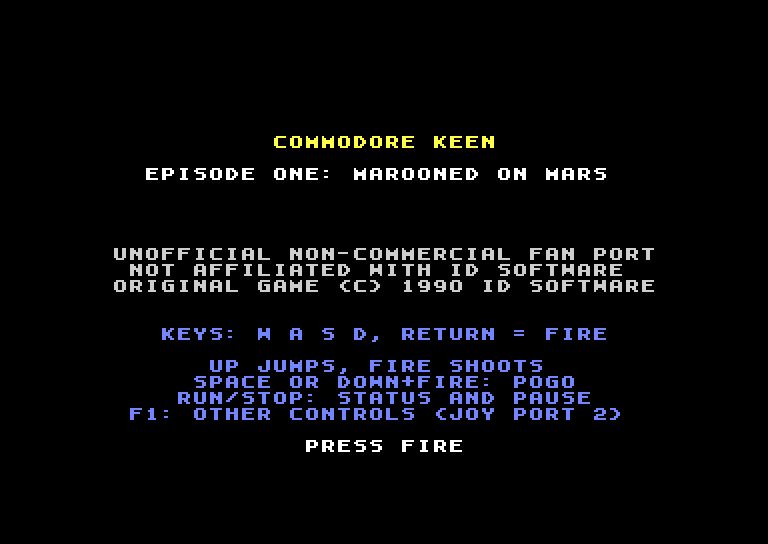
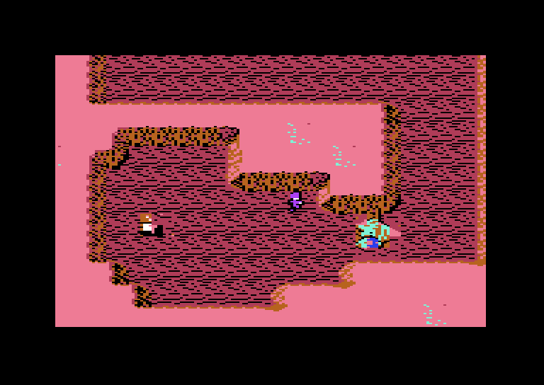
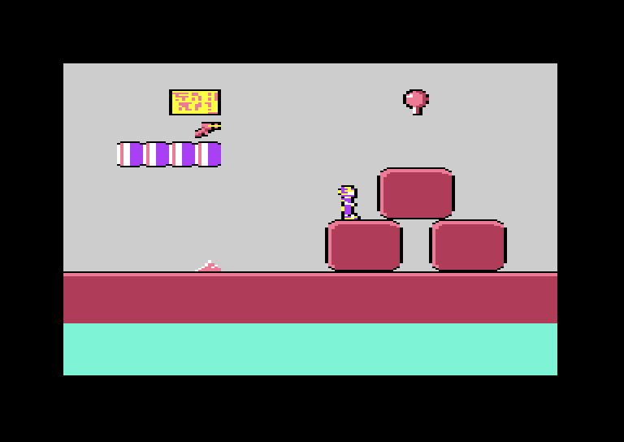
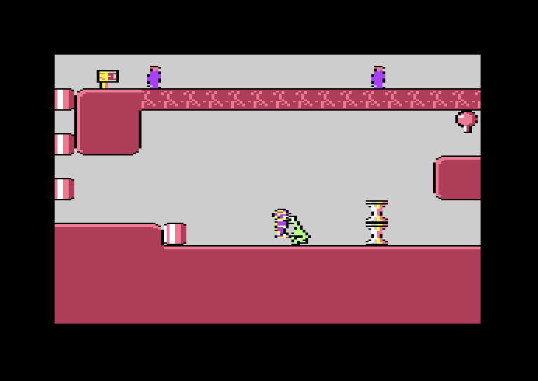
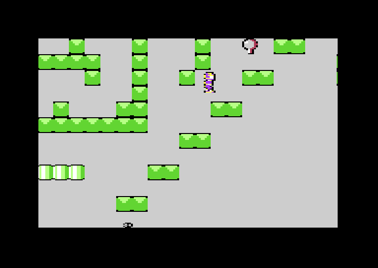
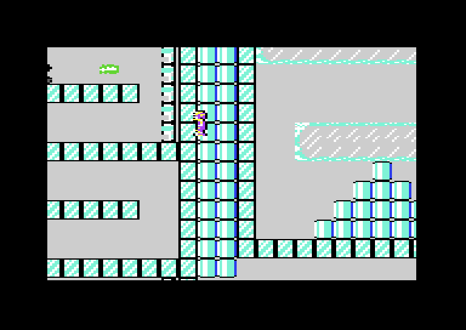
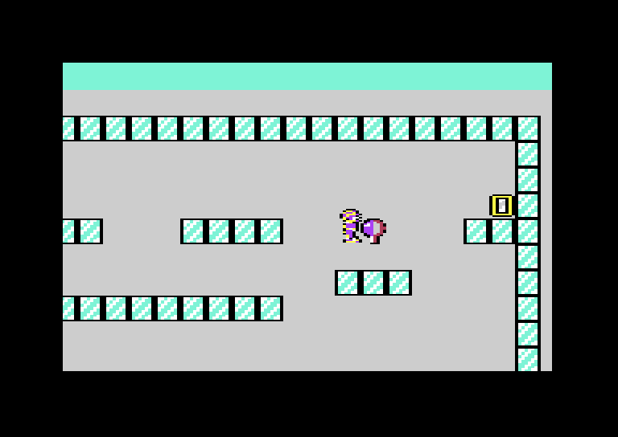

# Commodore Keen

**Commodore Keen** is an unofficial, non-commercial fan port of *Commander Keen 1: Marooned on Mars* (id Software, 1990) for the stock PAL Commodore 64, written in 6502 assembly. **Not affiliated with id Software.**



| | |
| --- | --- |
|  |  |
| The world map of Mars | Level 1 |
|  |  |
| Level 3: a Garg next to Keen | Level 7 |
|  |  |
| Level 8 | Level 10 |

*Screenshots from VICE (PAL), taken by `tools/screenshots.py` while the game plays a planned route.*

## Play it

Download `commodore-keen.d64` from the **Releases** page of this repository.

- **VICE**: drag the `.d64` onto `x64sc`, or run `x64sc -autostart commodore-keen.d64`.
- **Real C64 with a 1541** (or SD2IEC, Pi1541): `LOAD"*",8,1` and `RUN`. Loading the game takes a while with the standard KERNAL loader (about half a minute, then a few seconds per level).
- **C64 Ultimate / Ultimate 64 / 1541 Ultimate**: mount the `.d64` in drive A and run the first file, or from a checkout: `C64U_HOST=<ip> python tools/deploy.py`.

The game needs a PAL or NTSC C64 with 64 KB and a disk drive as device 8. No REU, no turbo, no cartridge.

## The game

Billy Blaze, eight-year-old genius, builds a spaceship in his backyard and puts on his brother's football helmet: he is **Commander Keen**. While exploring Mars, the Vorticons steal four vital parts of his ship, the *Bean-with-Bacon Megarocket*. Keen has to find them in the Martian cities and shrines before he can fly home:

| Ship part | Where |
| --- | --- |
| Joystick | somewhere on Mars |
| Battery | somewhere on Mars |
| Vacuum cleaner | somewhere on Mars |
| Everclear (fuel) | somewhere on Mars |

Walk across the **world map**, enter a city with fire, and find its exit. Finished levels are marked on the map; some levels open the way to others. When Keen carries all four parts, walk back to the ship.

### Things to pick up

- **Candy, soda, pizza, books and teddy bears**: points (100 to 5,000). An extra life every 20,000 points.
- **Raygun**: 5 shots. The raygun stops most enemies.
- **Pogo stick** (in one of the shrines): bounce much higher than Keen can jump. It is needed to finish the game.
- **Keycards** (yellow, red, green, blue): open the doors of the same colour in that level.

### Martians

| Enemy | Behaviour |
| --- | --- |
| Yorp | one-eyed, harmless but pushes Keen around; jump on its head to stun it |
| Garg | charges when it sees Keen: deadly. Jump over it or shoot it |
| Vorticon | jumps towards Keen: deadly, needs several shots |
| Butler robot | pushes Keen, immune to the raygun |
| Tank robot | patrols and fires: its shots are deadly, the robot itself is immune |
| Ice cannon | fires ice that freezes Keen for a moment |

Watch out for fire, spikes and other deadly tiles, and do not fall off the map.

## Controls

Joystick in port 2, or the keyboard.

| Action | Joystick | Keyboard |
| --- | --- | --- |
| Walk | left / right | A / D |
| Jump | up | W |
| Shoot | fire | RETURN |
| Pogo on/off | down + fire, or space | S + RETURN, or space |
| Enter a level (map) | fire | RETURN |
| Status and pause | RUN/STOP | RUN/STOP |

**F1** on the title screen switches to the alternative layout: fire jumps, down + fire shoots, space toggles the pogo stick. The keys act as a second joystick (W A S D = up, left, down, right; RETURN = fire), so they follow the chosen layout too. Use the joystick or the keys: joystick 2 shares lines with the keyboard, and both at once can give ghost key presses.

## How it fits in a C64

- **Smooth 8-way scrolling at 25 frames per second**: two screens in VIC bank 3, the next one drawn in the background, swapped in the raster interrupt; colour RAM is updated by code generated at startup (13 cycles per character).
- **EGA graphics as multicolour characters**: per level 3 shared colours plus 1 own colour per character, up to 240 characters; animated tiles get their own characters.
- **Keen as two layered hardware sprites** (yellow and purple), enemies and shots on the other six sprites.
- **Physics measured in DOSBox**: walking speed, jump height and gravity per 1/16 pixel per tick, in tables so NTSC uses the same values (5 game ticks per 6 frames, with sound tempo and pitch corrected).
- **Sound effects** from the original's PC speaker data, played on the SID.
- **Everything crunched with Exomizer**: the levels, sprites and sounds of the whole episode fit on one 1541 disk.

## Status

| | |
| --- | --- |
| Works | title screen, world map with teleporters and barriers, all 16 levels, items, doors, enemies, raygun, pogo stick, status screen, game over and the ending; PAL and NTSC; joystick and keyboard |
| Proven | a planner plays the real 6502 code in py65 and finds routes through levels 1-11, 13, 14 and 16; the routes from a fresh game replay in VICE to the exit without losing a life |
| Blocking | in level 16 the everclear (the last ship part) cannot be reached yet: it lies next to the exit, and Keen always touches the exit first. How the original handles this has to come from the reconstructed source |
| Not yet | music (needs tunes with permission), highscores, a faster loader; enemy behaviour and some physics are estimates until checked against the reconstructed source; tested in emulators only, not yet on real hardware |

Details: [docs/status.md](docs/status.md). Design and milestones: [PLAN.md](PLAN.md).

## Build it yourself

The repository contains no files from the original. The converter reads your own copy of the shareware episode.

You need:

- The files of Commander Keen 1 v1.31 (shareware) in `data/original/` (`KEEN1.EXE`, `EGAHEAD.CK1`, `EGALATCH.CK1`, `EGASPRIT.CK1`, `LEVEL*.CK1`, `SOUNDS.CK1`, …)
- Java, KickAssembler 5.25, VICE 3.9+ (`x64sc`, `c1541`), Exomizer 3.1, Python 3.11+ with Pillow, numpy, pytest and py65. `tools/toolchain.py` finds the tools via environment variables, in `../c64/` (java, kick, vice, exomizer, dosbox) or on the PATH; see [docs/toolchain.md](docs/toolchain.md).

```
python tools/build.py        # build/commodore-keen.d64
python tools/run.py          # start in VICE
python tools/test.py         # all tests (converter, py65, headless VICE)
python tools/deploy.py       # start on a C64 Ultimate (C64U_HOST=<ip>, C64U_PASSWORD if set)
python tools/screenshots.py  # the screenshots above
```

`python -m tools.convert` writes inspection images of the original to `build/original/`. `python -m tools.convert.export` writes the C64 assets to `build/assets/`.

### Structure

- `tools/convert/`: reads the original formats (LZEXE, LZW, RLEW, EGA, sounds) and converts them to C64 characters, sprites and sound data
- `src/engine/`: scrolling, IRQ, loading, Exomizer decruncher, sound
- `src/game/`: Keen, enemies, items, keyboard, world map, text screens, game flow
- `tools/planner.py`, `tools/episode.py`: search joystick input that finishes levels, with the real game code in py65
- `tests/`: pytest; py65 tests of 6502 routines; VICE scenarios with scripted input; DOSBox comparisons (`-m dosbox`)
- `docs/`: decisions (ADRs), formats, physics, enemies, memory map, frame budget, credits

## Rights

Commander Keen is a trademark of its owner. The disk image and the screenshots contain converted graphics, levels and sounds of the original shareware episode. They are shared free of charge, with this disclaimer, and will be taken offline if the rights holder asks. See [docs/credits.md](docs/credits.md).
